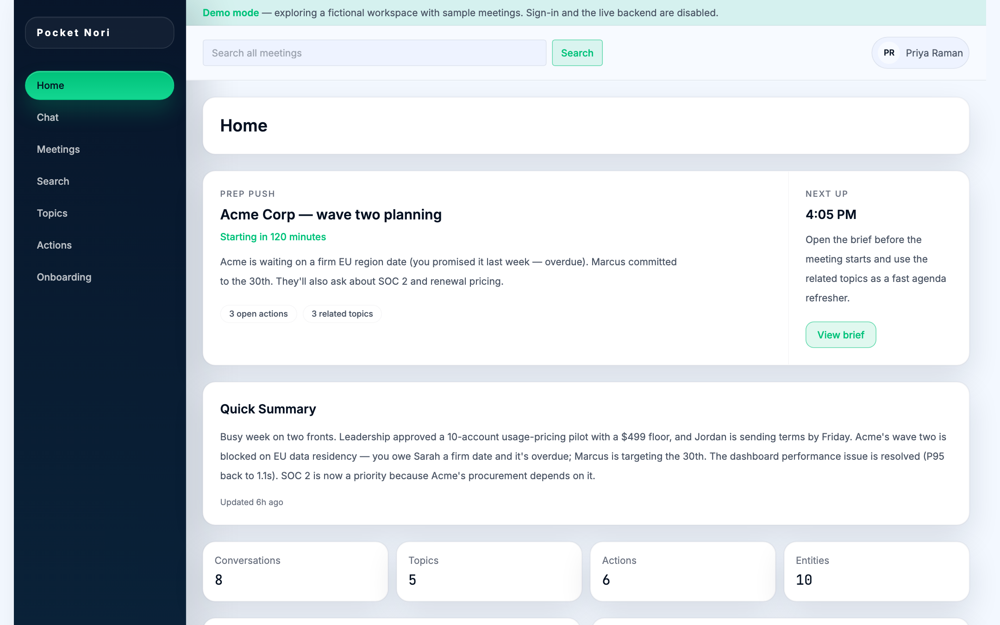
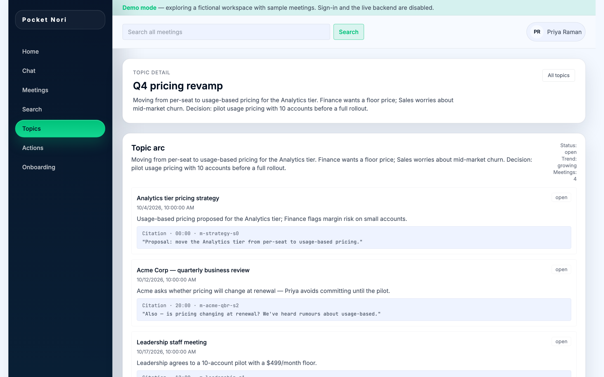
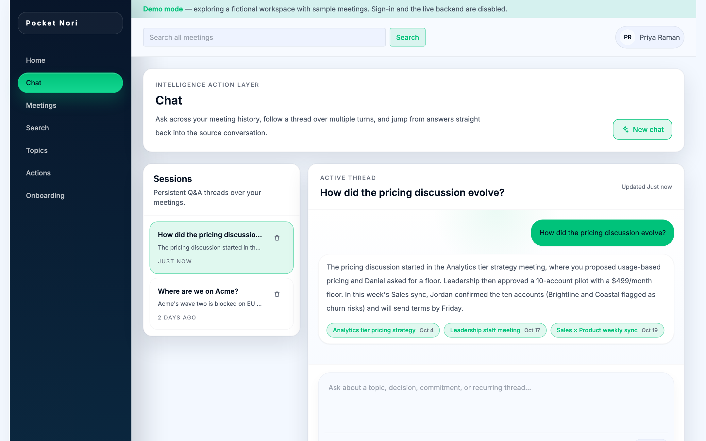
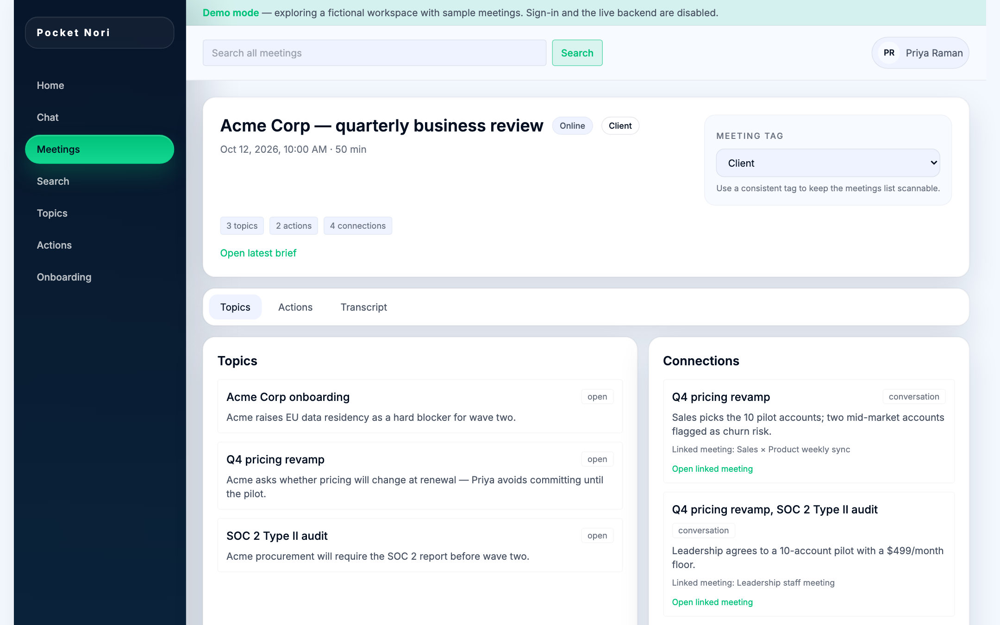
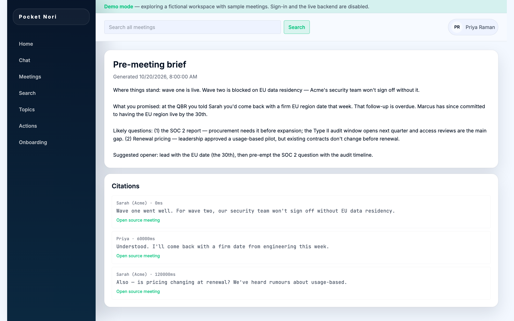
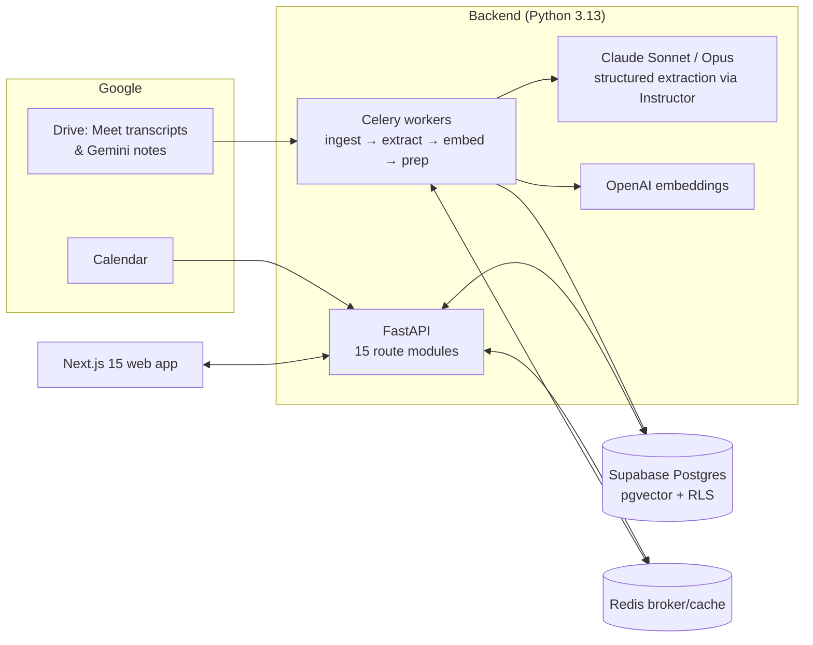

# Pocket Nori

**A personal intelligence layer for working professionals.** Pocket Nori reads your meeting transcripts, pulls out topics, decisions, commitments and the people involved, and links them across meetings, so you can see how a topic developed instead of digging through recordings.

**▶ Demo video (4 min): [watch on Loom](https://www.loom.com/share/2f20bf4abdab4088b132b8ee03b2fb20)** · **Live demo: [pocket-nori.vercel.app](https://pocket-nori.vercel.app)**, no sign-in needed. It runs on a fictional sample workspace.



## Why

Decisions get made across many meetings with many audiences, and the reasoning behind them gets scattered:

- **Decisions lose their trail.** A choice is proposed in one meeting, refined in a second and confirmed in a third. Later, nobody can say where it was decided or why.
- **Recurring topics get buried.** A thread comes up for two minutes in each of six standups. No single transcript tells the whole story.
- **Context gets lost between audiences.** What a customer asks for, what leadership approves and what engineering commits to sit in separate meetings. The only link between them is whoever happened to attend all three.

Pocket Nori keeps that context for each person, privately, and turns it into answers.

## What it does

| | |
|---|---|
| **Topic arcs** | Groups mentions of the same topic across meetings into one timeline (proposed → debated → decided → shipped), with a transcript citation at every step. |
| **Cross-meeting connections** | Finds where the same topic, person or commitment shows up in different meetings, for example a customer's request in a sales call and the related feasibility discussion in a sprint review. |
| **Commitments tracker** | Pulls out commitments and follow-ups with owners and due dates, and can draft the follow-up email for you. |
| **Pre-meeting briefs** | Before a calendar event, sends a brief covering what was said last time, what is still open, and the questions likely to come up. |
| **Cited chat & search** | Ask questions across your whole meeting history and get streamed answers grounded in, and linked back to, the exact transcript segments they came from. |
| **Entity resolution** | Merges "Marcus", "Marcus Lee" and "@marcus" into one canonical person, company, product or project. |

<table>
<tr>
<td><br/><sub>Topic arc with transcript citations</sub></td>
<td><br/><sub>Streaming chat with source citations</sub></td>
</tr>
<tr>
<td><br/><sub>Meeting detail: topics, actions, connections</sub></td>
<td><br/><sub>Auto-generated pre-meeting brief</sub></td>
</tr>
</table>

## Try it

**Watch:** [4-minute demo video](https://www.loom.com/share/2f20bf4abdab4088b132b8ee03b2fb20)

**Online:** [pocket-nori.vercel.app](https://pocket-nori.vercel.app)

**Locally:** the frontend includes a **demo mode** that runs fully in the browser on a fictional workspace (8 meetings, 5 topic arcs, actions, entities, briefs and chat), with no sign-in and no backend needed:

```bash
cd frontend
npm install
NEXT_PUBLIC_DEMO_MODE=true npm run dev
# open http://localhost:3000
```

## Architecture



**Pipeline.** A transcript goes through five stages: segmentation, entity extraction, two-tier topic candidate identification, filtering, and resolution against existing topics. The output is stored as a typed **knowledge graph** in Postgres: topic nodes, entity nodes and evidence-backed edges, with provenance links back to transcript segments. pgvector handles semantic retrieval. No separate graph database is needed. See [`docs/specs/Knowledge_graph.md`](docs/specs/Knowledge_graph.md).

**Privacy.** Every user-owned table is protected by Postgres row-level security. CI runs an isolation suite that checks User A's JWT cannot read any of User B's rows ([`scripts/rls_isolation`](scripts/rls_isolation)).

## Tech stack

| Layer | Technology |
|---|---|
| Frontend | Next.js 15 (App Router), React 19, TypeScript, Tailwind CSS, SWR |
| API | FastAPI, Pydantic v2 |
| Workers | Celery + Redis |
| LLMs | Anthropic Claude (extraction, briefs, chat) via Instructor; OpenAI `text-embedding-3-small` |
| Data | Supabase Postgres + pgvector, row-level security, 17 SQL migrations |
| Auth | Google OAuth (Drive + Calendar scopes), httpOnly session cookies, CSRF middleware |
| Infra | Render (API + worker + Redis), Vercel (frontend), GitHub Actions CI |

## Repository layout

```
src/            FastAPI app, API routes, Celery workers, knowledge-graph + topic/entity stores
frontend/       Next.js web app (src/lib/demo-*.ts = demo mode)
migrations/     Postgres schema, RLS policies, pgvector indexes
tests/          pytest suite (routes, workers, extraction, graph, RLS)
scripts/        Rollout/backfill helpers, QA check, RLS isolation harness
docs/           Product specs, technical specs, design system, build log
```

## Running the full stack locally

```bash
# Backend
python3.13 -m venv .venv && source .venv/bin/activate
pip install -e ".[dev]"
cp .env.example .env            # fill in Supabase, Anthropic, OpenAI, Google OAuth, Redis
uvicorn src.main:app --reload   # API on :8000
celery -A src.workers.combined worker --loglevel=info

# Frontend
cd frontend && npm install && npm run dev   # app on :3000
```

Apply the SQL files in `migrations/` to your Supabase project, in order.

## Tests

```bash
pytest                            # backend suite
cd frontend && npm run lint && npm run build
```

## Docs

- [Knowledge graph](docs/specs/Knowledge_graph.md) · [Design system](docs/design/system.md)
