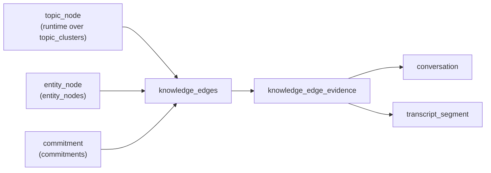

# Knowledge Graph — Current Final Implementation

This document captures the knowledge graph that is actually persisted and queried in the current Pocket Nori backend. It reflects the implementation introduced with migrations `014`, `017`, and `018`, plus the graph materialization and query helpers in `src/knowledge_graph.py`.

It is an implementation reference for graph work. Product intent still comes from `pocket-nori-prd.md`, and topic extraction behavior still comes from `docs/specs/Topic_intelligence.md`.

---

## 1. Purpose

The current graph is a personal, per-user context graph used to:

- store durable typed relationships between canonical topics, canonical entities, and commitments
- attach every stored relationship to meeting-level and segment-level evidence
- drive graph-backed connection detection across meetings
- support explainable graph APIs for neighbors, per-conversation subgraphs, and path finding

It is not a global graph, shared workspace graph, or cross-user graph. The user's Index remains the privacy boundary.

---

## 2. Canonical graph nodes

The persisted graph has exactly three node types:

| Node type | Physical storage | How it is created | Label used in graph responses |
|---|---|---|---|
| `topic_node` | `topic_clusters` via the TopicNode bridge | topic pipeline resolves `topics.cluster_id` to a canonical topic identity | `topic_clusters.canonical_label` |
| `entity_node` | `entity_nodes` | entity merge/assignment at write time sets `entities.entity_node_id` | `entity_nodes.canonical_name` |
| `commitment` | `commitments` | commitment extraction during meeting ingest | `commitments.text` |

### Important implementation note

`topic_node` is a runtime abstraction today. Physical `topic_nodes` table cutover is still deferred. The live backend uses:

- `topic_clusters` as the backing table
- `topics.cluster_id` as the foreign key to the canonical topic identity
- `src/topic_node_store.py` as the bridge layer that exposes TopicNode semantics

Conversations are not first-class graph nodes. They appear only as evidence containers attached to edges.

---

## 3. Edge storage

Graph edges are stored in `knowledge_edges`.

### `knowledge_edges`

Each row represents one typed relationship between two graph nodes:

- `user_id`
- `source_type`, `source_id`
- `target_type`, `target_id`
- `relation_type`
- `confidence`
- `evidence_count`
- `first_seen_at`
- `last_seen_at`

Constraints and behavior:

- endpoints must be one of `topic_node`, `entity_node`, or `commitment`
- rows are unique per user on `(source_type, source_id, target_type, target_id, relation_type)`
- `co_mentioned` is normalized as a symmetric relation, so endpoint order is canonicalized before insert
- all other relations preserve direction

### `knowledge_edge_evidence`

Each edge can have many evidence rows. Every evidence row points to:

- `edge_id`
- `user_id`
- `conversation_id`
- optional `segment_id`
- optional `snippet`

This is the explainability layer. It answers: "Which meeting caused this edge to exist, and what line of transcript supports it?"

Evidence is deduplicated per user, edge, conversation, and segment.

---

## 4. Relation vocabulary actually used

The live graph supports a fixed relation vocabulary.

### Deterministic core relations

These are materialized directly from extracted meeting structure:

| Relation | Endpoints | Meaning | Confidence used |
|---|---|---|---|
| `co_mentioned` | `entity_node` ↔ `entity_node` | two canonical entities appeared in the same meeting context | `0.90` |
| `discussed_in_context` | `topic_node` → `entity_node` | a canonical topic and a canonical entity were both grounded in the same meeting | `0.88` |
| `assigned_to` | `commitment` → `entity_node` | a commitment is attributed to a resolved person entity node | `0.95` |

### Additive explicit relations from the LLM layer

These are optional and only added when the relation extractor can map both endpoints to already-known nodes in the current conversation:

- `works_on`
- `owns`
- `reports_to`
- `manages`
- `uses`
- `depends_on`
- `decided`
- `blocked_by`
- `client_of`
- `partner_of`

These relations are additive only. If extraction fails, the deterministic graph still stands.

---

## 5. How graph materialization works

`materialize_conversation_graph()` is the canonical write path for one conversation.

### Step 1: Load conversation-scoped derived rows

For one conversation, the backend loads:

- `topics`
- `entities`
- `commitments`
- the segment-link tables:
  - `topic_segment_links`
  - `entity_segment_links`
  - `commitment_segment_links`
- the referenced `transcript_segments`

This gives every candidate node a set of grounded transcript segments.

### Step 2: Collapse meeting-local rows to canonical node identities

The graph does not connect raw topic or entity mention rows directly.

- topic mention rows are grouped by `topics.cluster_id` into `topic_node`
- entity mention rows are grouped by `entities.entity_node_id` into `entity_node`
- commitments remain direct rows in `commitments`

### Step 3: Create deterministic edges

The current implementation then creates:

1. one `co_mentioned` edge for every pair of distinct entity nodes in the conversation
2. one `discussed_in_context` edge for every topic node / entity node pair in the conversation
3. one `assigned_to` edge from each commitment to the resolved owner entity node, when the owner name can be matched to a `person` entity node

Evidence selection rules:

- if two nodes share transcript segments, the earliest shared segment is used
- otherwise the earliest segment from the combined evidence is used
- snippets are normalized whitespace and truncated to 220 characters

### Step 4: Run bounded explicit relation extraction

The backend then builds a compact structured context containing:

- conversation title
- the topic-node labels in the meeting
- the entity-node labels in the meeting
- commitment texts
- a short list of supporting snippets

That context is sent through `llm_client.extract_relations()`.

A returned relation is inserted only when:

- `source_type` and `target_type` are valid graph node types
- the source label maps to a known topic, entity, or commitment in this conversation
- the target label maps to a known topic, entity, or commitment in this conversation
- source and target resolve to different IDs

The extractor cannot create new node identities. It can only add typed edges between nodes that already exist in the conversation-local graph context.

### Step 5: Update edge metadata

When evidence is inserted for an existing edge:

- `evidence_count` increments
- `confidence` becomes the maximum seen confidence for that edge
- `first_seen_at` becomes the earliest observation
- `last_seen_at` becomes the latest observation

This makes the edge stable across repeated meetings while keeping a rolling evidence trail.

---

## 6. Evidence model

The current graph is intentionally evidence-first.

- every edge is justified by at least one `knowledge_edge_evidence` row
- evidence always points to a single user-owned conversation
- evidence can optionally point to the exact `transcript_segments.id`
- graph APIs return evidence snippets so the UI can explain why a relationship exists

This preserves the PRD requirement that derived intelligence remains traceable to source conversations and timestamps.

---

## 7. Query surfaces

The live graph currently exposes three read APIs in `src/api/routes/graph.py`.

### `GET /graph/neighbors/{node_type}/{node_id}`

Returns all incident edges for one node, with:

- hydrated source and target labels
- relation type
- confidence
- evidence count
- first and last seen timestamps
- up to 5 evidence rows per edge

### `GET /graph/subgraph?conversation_id=...`

Returns the graph slice justified by one conversation:

- all nodes touched by evidence rows for that conversation
- all edges referenced by those evidence rows
- evidence attached to each returned edge

### `GET /graph/path?from_id=...&to_id=...`

Finds a path between two node IDs using BFS over `knowledge_edges`.

Important current behavior:

- node IDs are resolved against `topic_clusters`, `entity_nodes`, and `commitments`
- path search treats edges as traversable in both directions for discovery, even when the stored relation itself is directional

---

## 8. How connections are derived from the graph

`connections` is still the compatibility read model used by dashboard and meeting surfaces. It is not the canonical graph store.

`materialize_connections_for_conversation()` rebuilds that read model by combining:

- shared topic-node IDs across conversations
- shared entity-node IDs across conversations
- matching commitment signatures across conversations
- overlap in `knowledge_edge_evidence.edge_id`

Candidates are ranked by weighted overlap:

- shared topics: weight `3`
- shared entities: weight `2`
- shared commitments: weight `1`
- graph evidence overlap: weight `1`

The result is stored back into legacy `connections` plus `connection_linked_items`.

So the current architecture is:

- `knowledge_edges` plus `knowledge_edge_evidence` is the canonical relationship layer
- `connections` is a derived, user-facing compatibility layer

---

## 9. Privacy and isolation guarantees

The graph obeys the repo's non-negotiable privacy constraints:

- `knowledge_edges` and `knowledge_edge_evidence` both have `ENABLE ROW LEVEL SECURITY` and `FORCE ROW LEVEL SECURITY`
- all policies enforce `auth.uid() = user_id`
- all graph reads and writes are user-scoped
- workers use the user's JWT for graph operations
- there is no cross-user node merge, cross-user edge, or shared evidence table

This graph is part of the user's private Index, not a shared organizational memory graph.

---

## 10. Final graph shape in the current backend

### Practical summary

If you are working on the graph today, the final used model is:

1. canonical topics via the TopicNode bridge over `topic_clusters`
2. canonical entities via `entity_nodes`
3. direct commitments via `commitments`
4. typed edges in `knowledge_edges`
5. explainable support rows in `knowledge_edge_evidence`
6. graph-backed connection cards derived from those edges and evidence

That is the graph Pocket Nori currently materializes, backfills, queries, and exposes.
